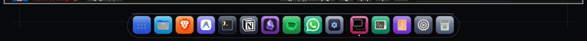
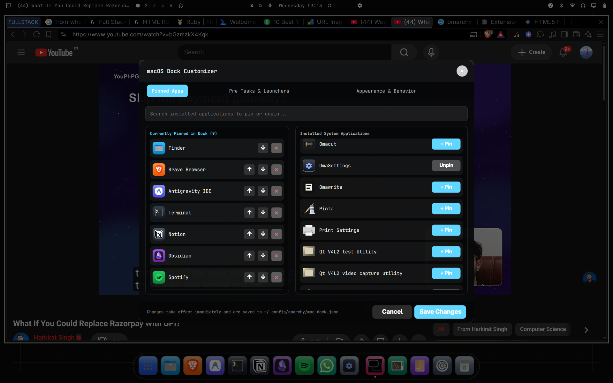
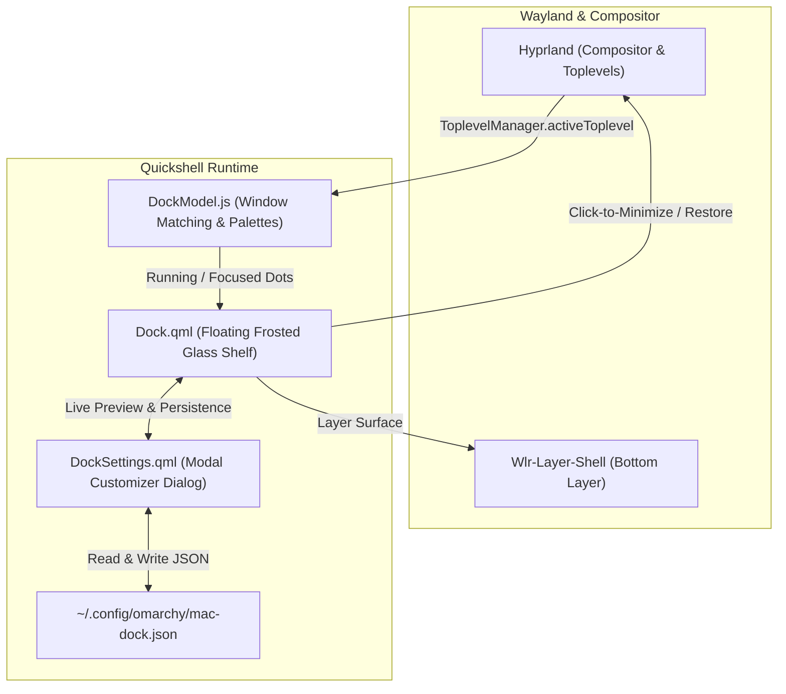

<div align="center">

#  Omarchy macOS Dock

### The modern, frosted-glass macOS floating dock for Omarchy Linux & Hyprland

[](LICENSE)
[](https://github.com/hari45wavin/omarchy-mac-dock)
[](https://github.com/outfoxxed/quickshell)
[](CONTRIBUTING.md)
[](https://github.com/hari45wavin/omarchy-mac-dock/stargazers)

<br/>

<p align="center">
  
</p>

*Elevate your Linux desktop with an ultra-smooth, translucent frosted-glass macOS dock built natively for Omarchy on Wayland.*

[Features](#-key-features) • [Quick Install](#-quick-installation) • [Customizer](#-dock-customizer--settings) • [Architecture](#-architecture) • [Contributing](#-contributing)

</div>

---

## ✨ Key Features

- **🍎 macOS Floating Glass Shelf** — Translucent frosted-glass backdrop with specular rim reflections, theme-aware blending, and ambient depth shadows.
- **🎨 Vibrant Squircle Icons** — Handcrafted gradient palettes, crisp vector icon rendering, glossy highlights, and automatic fallback glyphs for any application.
- **🌊 Interactive Hover Magnification** — Smooth cubic-bezier zoom animation as your cursor sweeps across the dock shelf.
- **🟢 Hyprland Window Tracking & Active Dots** — Live window state indicators (illuminated pill for the focused window, glowing dot for background running apps).
- **🪟 Click-to-Minimize & Toggle Focus** — Click an active app's dock icon to instantly minimize it into Hyprland's scratchpad; click again to restore it seamlessly.
- **🚀 Pre-Task System Launchers & Modules**:
  - 📱 **Launchpad / Menu** — Quick-open Omarchy application menu with a native 3x3 grid icon.
  - 🖥️ **Mission Control** — Workspace switcher displaying the active Hyprland workspace number.
  - 📈 **Activity Monitor** — One-click launcher for system performance monitoring.
  - 📦 **Plugin Store (Omaplug)** — Instant access to installed Omarchy extensions.
  - ⚙️ **Dock Customizer** — Dedicated gear module to open settings anytime.
  - 🗑️ **Trash Bin** — Direct shortcut to your desktop trash folder.
- **🎛️ Live In-App Customizer Dialog** — Search through all installed system apps, pin or unpin with one click, drag/reorder apps, and resize the dock live from Compact (38px) up to XL (72px).

---

## 📸 Screenshots

### 🎛️ Built-in macOS Dock Customizer
Right-click anywhere on the dock or click the settings gear to open the native customizer. All size changes, pinned app reordering, and preference toggles update live!

<div align="center">
  
</div>

---

## ⚡ Quick Installation

### One-Line Automated Install
Run the interactive installer directly in your terminal:

```bash
curl -sSL https://raw.githubusercontent.com/hari45wavin/omarchy-mac-dock/main/install.sh | bash
```

### Manual Installation

1. **Clone the repository:**
   ```bash
   git clone https://github.com/hari45wavin/omarchy-mac-dock.git
   cd omarchy-mac-dock
   ```

2. **Run the installer:**
   ```bash
   chmod +x install.sh
   ./install.sh
   ```

3. **Align Omarchy Status Bar to Top (Recommended):**
   For the authentic macOS look (menu bar at the top, floating dock at the bottom), ensure `"position": "top"` in `~/.config/omarchy/shell.json`:
   ```json
   {
     "bar": {
       "position": "top"
     }
   }
   ```

4. **Restart Omarchy Shell:**
   ```bash
   omarchy-restart-shell
   ```

---

## 🎮 Controls & Shortcuts

| Action | How to Trigger |
| :--- | :--- |
| **Launch App** | Left-click an unpinned or closed app icon |
| **Focus App** | Left-click a running app icon |
| **Minimize App** | Left-click an already-focused app icon |
| **Open Customizer** | Right-click any icon, or right-click the empty dock shelf, or click the Settings Gear |
| **Toggle Dock Shelf** | Hotkey: <kbd>SUPER</kbd> + <kbd>CTRL</kbd> + <kbd>SHIFT</kbd> + <kbd>M</kbd> |
| **IPC Show / Hide** | `omarchy-shell omarchy-mac-dock toggle` |

---

## ⚙️ Configuration (`~/.config/omarchy/mac-dock.json`)

All dock settings persist automatically to `~/.config/omarchy/mac-dock.json`. You can edit it through the Customizer GUI or directly in JSON:

```jsonc
{
  "version": 1,
  "dockSize": 48,               // Base icon size in pixels (38 - 72)
  "magnification": true,        // Enable hover zoom effect
  "maxScale": 1.25,             // Zoom multiplier on hover
  "glassOpacity": 0.45,         // Translucency of frosted glass shelf
  "reserveSpace": true,         // Tile windows above dock (false = floating overlap)
  "bottomMargin": 10,           // Margin from bottom edge of screen
  "clickToMinimize": true,      // Click focused app to minimize
  "preTasks": {
    "showLauncher": true,       // 3x3 App Launchpad
    "showWorkspaces": true,     // Mission Control indicator
    "showActivityMonitor": true,// CPU/RAM monitor shortcut
    "showPluginManager": true,  // Omaplug manager shortcut
    "showSettings": true,       // Customizer gear shortcut
    "showTrash": true           // Trash bin shortcut
  },
  "pinnedApps": [
    {
      "id": "org.gnome.Nautilus",
      "name": "Finder",
      "desktopFile": "org.gnome.Nautilus.desktop",
      "icon": "org.gnome.Nautilus",
      "gradientStart": "#38bdf8",
      "gradientEnd": "#0284c7"
    }
    // Add additional apps as desired
  ]
}
```

---

## 🏛️ Architecture



---

## 🗺️ Roadmap & Upcoming Features

- [ ] **Intelligent Auto-Hide (Intellihide)**: Automatically hide dock when an active window overlaps the shelf.
- [ ] **Drag-and-Drop Pinning**: Drag icons directly from the desktop or file manager into the shelf to pin.
- [ ] **Trash Bin Empty / Full State**: Dynamically show crumpled paper in the trash icon when items are deleted.
- [ ] **Multi-Monitor Placement**: Configure independent docks or mirror across multiple displays.
- [ ] **App Notification Badges**: Display unread count badges for chat apps (Discord, Slack, WhatsApp, Telegram).
- [ ] **Window Preview Tooltips**: Show live Hyprland window thumbnails on icon hover.

Check out our [open issues](https://github.com/hari45wavin/omarchy-mac-dock/issues) to see what we're working on and vote with a 👍!

---

## 🤝 Contributing

Contributions make the open-source community an amazing place to learn, inspire, and create. Any contributions you make are **greatly appreciated**.

Please read our [Contributing Guide](CONTRIBUTING.md) before submitting pull requests.

---

## 📄 License

Distributed under the **MIT License**. See [`LICENSE`](LICENSE) for more details.

<div align="center">
  <sub>Crafted with ❤️ for Omarchy Linux and the Hyprland community. If you love this project, please consider giving it a ⭐!</sub>
</div>
